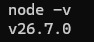
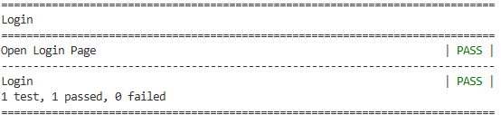

# Keskeneräinen harjoitustyö

Tämä harjoitustyö on toteutettu loppuvuonna 2026 osana kurssia Ohjelmistokehityksen teknologioita (ajankohtaiset teknologiat) ja työn tavoitteena on tutustua ja opiskella itsenäisesti testiautomaatiotyökalun Robot Framework käyttöä.

## Taustat ja johdanto

Tässä tiedostossa kerron ohjeet tämän projektin pystyttämiseen, pyrkien syventämään tietoutta tarpeellisista vaiheista otettaessa Robot Frameworkia käyttöön, kirjastona käytän Browseria. Kerron hieman yleistä tietoa Robot Frameworkista sekä ohjeistuksen, minkälaisiin testitapauksiin kehitän ja suoritan testit Robot Frameworkilla tässä repositoriossa. Testattavien asioiden ohjeistus mukailee kurssin toista tehtävänantoa, joka on laadittu Playwright-testien tekemiseen. Eli olen kurssilla aiemmin toteuttanut nämä samat testit kertaalleen, mutta työkalulla Playwright ja kielenä TypeScript. Nyt opettelen itsenäisesti Robot Frameworkia tämän harjoitustyön parissa, kokemusta Robot Frameworkista minulla ei ennestään ole. Lisäksi osana harjoitustyötä laadin automaatiotestit toiseen sovellukseen, tähän palaan dokumentin myöhemmissä vaiheissa. 

*”Tutustun Robot Frameworkiin ja koitan tehdä saman harjoituksen kuin teimme Playwright-tehtävässä. Mahdollisuuksien mukaan, kun aikaa riittää, kirjoitan Robot-testejä Ohjelmistoprojekti 1 -sovelluksellemme.”*

## Aloitus ja asennus

Harjoitustyöni aloitin luomalla Ohjelmistoprojekti 1 -sovelluksellemme robot-testejä. Sen jälkeen perustin tämän repositorion, sekä projektini lokaaleille tiedostoille virtuaalisen ympäristön.

Virtuaalisen ympäristön saat halutessasi näillä komennoilla (Windows), jotka ajetaan projektin juuressa, ennen muita Robot Frameworkin asennuksia:

```cmd
python -m venv .venv
.venv\Scripts\activate.bat
```

Virtuaalinen ympäristö eristää projektin riippuvuudet, estäen mahdolliset kirjastojen versioristiriidat, tehden projekteista toimintavarmempia (vanhat projektit ei rikkoudu version muuttuessa, kun tehdään uusia projekteja). Samalla myös järjestelmä ja Python-asennus pysyy puhtaampana, kun aliriippuvuudet ovat omissa virtuaaliympäristöissään. (https://docs.python.org/3/library/venv.html).

Mielenkiinnosta aihetta kohtaan löysin artikkelin, jossa Python-kehittäjä Marcin Kozak kehoittaa käyttämään virtuaaliympäristöjä heti alusta alkaen, jotta aloittelija voi säästyä myöhemmiltä harmeilta: https://medium.com/data-science/python-virtual-environments-why-and-when-should-you-use-them-be57b0c0323d.


Tämän jälkeen otetaan käyttöön Robot Framework:

```cmd
pip install robotframework
pip install robotframework-browser
rfbrowser init chromium
```

HUOM. Itse ajoin nämä komennot ongelmitta, koska koneellani on NodeJS. Mikäli se puuttuu, rfbrowser init ei luultavasti onnistu (https://medium.com/@zorozeri/test-automation-using-robot-framework-with-browser-library-1-f994af6f78b1). Tämän vuoksi voi olla suositellumpaa suorittaa asennus seuraavalla komennolla, jolloin NodeJS:ää ei tarvita (https://robotframework-browser.org/#start), koska se tulee lisäosana:

```cmd
py -m pip install "robotframework-browser[bb]"
```

Halutessasi voit tarkastaa onko NodeJS asennettuna. Jos on, saat tuloksena versionumerot:

```cmd
node -v
npm -v
```
  


Kun Robot Framework ympäristö on kunnossa, voit muutaman testin tehtyäsi taikka myöhemmin, ajaa vielä tämän:

```cmd
pip freeze > requirements.txt
```

Tiedostosta requirements.txt käyvät ilmi projektin riippuvuudet. Versionumeroiden tallentaminen tiedostoon mahdollistaa, että muut projektin jäsenet (tässä projektissa heitä ei ole), taikka kuka vaan voi pystyttää testit täysin samanlaisessa ympäristössä. Mikäli et perustanut virtuaalista ympäristöä, requirements.txt listaa muidenkin projektiesi riippuvuudet, lista saattaa siinä tapauksessa olla pitkä.

## Ensimmäinen laatimani testi 

Aloitan laatimalla yksinkertaisen testin tiedostoon login.robot. Testi varmistaa vain selaimen ja testattavan sivuston aukeamisen. Sivuston title on nimetty "Example application", joten hyödynnän sitä:


### Ajan testin:

```cmd
py -m robot tests/login.robot
```




### Testien suorittamisen jälkeen muodostuvat:

- report.html – testiraportti
- log.html – testiloki
- output.xml – testitulokset

Nämä sekä mahdolliset muut testiajojen muodostamat tiedostot ja kansiot kannattaa lisätä tiedostoon .gitignore, jos projekti siirretään githubiin. Lisää sinne myös:

- .venv/ - virtuaaliympäristö
- browser/ - Browser-kirjaston tiedostot

Mikäli haluat ajaa testit headless -tilassa, jolloin testit suoritetaan ilman näkyvää selainta, niin testitiedostoon tulee lisätä headless=true.

##  Settings, Variables, Keywords ja Test Cases

Testitiedoston rakenne tyypillisesti pitää sisällään otsikon mukaisia osioita.

### Settings

Testin asetukset, kuten käytettävät kirjastot, testien tai testisarjan aloitus- ja lopetusasetukset sekä resurssitiedostot, jotka luodaan yksinkertaistamaan testien rakenteita.

### Variables

Osiossa määritellään käytettävät muuttujat, kuten URL-osoitteet tai muut toistuvat elementit, jolloin testien ylläpito helpottuu sekä tiedostosta saadaan helppolukuisempi.

### Keywords

Osiossa voidaan määritellä omia avainsanoja toistuvia "testiaskeleita" (esim. käyttäjätietojen syöttäminen) helpottamaan ja yksinkertaistamaan.

### Test Cases

Osio sisältää testitapaukset. Kaikki edellä lueteltujen osioiden asiat voisi sisällyttää tähän osioon, mutta se tekisi testitapauksista sekavia ja vaikealukuisia, lisäksi se olisi hyvien käytänteiden vastaista.

Lähde: https://www.theseus.fi/server/api/core/bitstreams/af44cbe9-620c-43c4-9cf0-a6aacfae1245/content.


## Testien toteuttaminen tehtävänannon mukaisesti

Tätä tehtävää suorittaessani käytän hyödykseni ensisijaisesti Robot Frameworkin virallista sivustoa https://docs.robotframework.org/. Sivustolle on koottu hyödyllisiä oppaita, kuten https://docs.robotframework.org/docs/getting_started/how_to_write_rf ja https://robotframework.org/robotframework/latest/RobotFrameworkUserGuide.html.  

Testit voidaan kirjoittaa vaikka muistioon ja ajaa komentokehotteen kautta, mutta koodieditorin käyttö tekee testien kirjoittamisesta huomattavasti mukavampaa, sekä helpottaa virheiden etsintää. Käytän tehtävää tehdessä VS Code Editoria, johon olen ladannut lisäosan RobotCode - Robot Framework Support. Nähtäväksi jää, auttaako lisäosa esimerkiksi koodivirheiden kanssa.

Testien kirjoittamista saattaa auttaa testin nauhoittaminen, jota en kuitenkaan itse käyttänyt. Tutkin kuitenkin, että saatavilla olisi kolmannen osapuolen paketti (https://pypi.org/project/robotframework-browser-recorder/), joka käyttää Playwrightin codegen-työkalua ja muuntaa tuloksen Robot Framework -syntaksiksi. Asennus tarvitaan:

```cmd
pip install robotframework-browser-recorder
```


### Tehtävänanto

Testattava sivusto: https://authentication-6o1.pages.dev/.  
Huom. sivustolla tehdyt rekisteröitymiset ja kirjautumiset ovat voimassa vain saman istunnon sisällä, eivätkä säily testitapausten välillä.

Tehtävässä hyödynnän aiemmin annetun Playwright-tehtävän valmiita käyttäjätunnuksia ja salasanoja, jotka piilotan ympäristömuuttujiin.

Kussakin testitapauksessa tulee tehdä tarkoituksenmukaiset toimet (Click Element, Input Text, jne.) ja vaadittavat tarkastukset (Should Be Equal, Element Should Be Visible, jne.), jotta voidaan varmistaa, että testattava toiminnallisuus toimii odotetusti. Testitapauksissa tulee huomioida myös tyypilliset virhetilanteet (väärä salasana, pakollinen kenttä, jne.) ja niiden käsittely.

#### Kirjautuminen (login.robot)

- Palvelun etusivulla tulee olla kirjautumislomake, jossa on kentät sähköpostille ja salasanalle, sekä kirjautumisnappi.
- Käyttäjä tulee ohjata onnistuneen kirjautumisen jälkeen osoitteeseen /dashboard, jossa näytetään tervetuloa-viesti.
- Rekisteröityneen käyttäjän tulee voida kirjautua sisään sähköpostilla ja salasanalla.
- Sekä käyttäjätunnus ja salasana ovat pakollisia, ja puuttuvista tiedoista tulee näyttää virheilmoitus.
- Kirjautumisen tulee huomauttaa, mikäli käyttäjätunnus on väärässä muodossa tai salasana on liian lyhyt.
- Kirjautumisen tulee estää kirjautumiset sekä tuntemattomalla käyttäjätunnuksella että väärällä salasanalla.  

Lisäksi:  

- Jos käyttäjä yrittää päästä suoraan /dashboard-sivulle ilman voimassa olevaa kirjautumista, hänet tulee ohjata kirjautumissivulle.
- Kun kirjautunut käyttäjä kirjatuu ulos käyttäen "Logout" -painiketta, hänet tulee ohjata kirjautumissivulle.

#### Rekisteröityminen (register.robot)

- Rekisteröitymiseen tulee päästä sekä suoraan /signUp-osoitteesta että etusivun "Sign up" -linkistä.
- Nimi, sähköposti ja salasana ovat rekisteröitymisessä pakollisia.
- Sähköpostin tulee olla oikeassa muodossa ja salasanan riittävän pitkä, ja virheellisistä tiedoista tulee näyttää virheilmoitus.
- Rekisteröitymisyritys jo rekisteröidyllä sähköpostilla näyttää virheilmoituksen.
- Rekisteröityminen kelvollisilla tiedoilla luo tunnuksen, näyttää onnistumisviestin ja ohjaa kirjautumissivulle.
- Rekisteröitymisessä luotua tiliä tulee voida käyttää kirjautumiseen heti rekisteröitymisen jälkeen (saman testitapauksen sisällä).


### Toteutus

Tehtävänantoon vastaavat testit loin tämän repositorion kansioon tests ja tiedostoihin login.robot sekä register.robot. Report.html on tärkeä apuväline, kun testi ei mene läpi: raportti kannattaa avata selaimeen ja sieltä saa hyvin osviittaa siitä, mikä kohta testissä epäonnistuu ja miksi.  

Alun haasteissa turvauduin Browser -kirjaston Record Selectorin käyttöön. Se ei nauhoita testiä, mutta palauttaa klikatun elementin selektorin:

```robotframework
*** Test Cases ***
Poimi selektori
    New Browser    chromium    headless=False
    New Page    https://authentication-6o1.pages.dev/
    ${selektori}=    Record Selector
    Log To Console    ${selektori}
    [Teardown]    Close Browser
```

Toinen haaste mitä kohtasin, oli etten saanut Robot Frameworkia suoraan lukemaan tiedostoa .env, jonne olen luetellut tunnukset ja salasanat. Tämän vuoksi loin erillisen python-tiedoston, jonka tehtävä on lukea arvot .env -tiedostosta ja antaa ne salaisina Robot-muuttujina testitiedostoille.

Tämä edellytti asennusta:

```cmd
pip install python-dotenv
```

Muistutuksena, kun asennetaan virtuaaliympäristössä, tulee komentokehotteessa näkyä se polun alussa:  
__(.venv)__ C:\Users\...

Päivitä myös requirements.txt.

Testitiedostossa otin salaiset muuttujat käyttöön:

```robotframework
*** Settings ***
Library      Browser
Variables    ../env.py
```

ja käytin niitä:
```robotframework
Fill Secret    input[type="email"]       ${JANE_USERNAME}
Fill Secret    input[type="password"]    ${JANE_PASSWORD}
```

Env.py ei sisällä salaisuuksia, joten riittää kun .gitignoressa on estettynä .env. ja results/.
Secret piilottaa arvot vain lokituksesta.

Env. -tiedostoni on muodossa:

```dotenv
JANE_USERNAME=muuta-osoite@example.com
JANE_PASSWORD='muuta-tieto'

JOHN_USERNAME=muuta-osoite@example.com
JOHN_PASSWORD='muuta-tieto'

ALICE_USERNAME=muuta-osoite@example.com
ALICE_PASSWORD='muuta-tieto'

BOB_USERNAME=muuta-osoite@example.com
BOB_PASSWORD='muuta-tieto'
```

VS Codeen asentamaani lisäosaa käytin lopulta hyvin vähän. Pari syntaksivirhettä sain sen avulla korjattua, mutta en varsinaisesti omaksunut lisäosan käyttöä mukaan testien kirjoittamiseen.


# Harjoitustyön toinen osuus

Sisällytin harjoitustyöhöni testien tekemisen kurssille Ohjelmistoprojekti 1. Olemme ko. kurssilla tehneet lipunmyynti-sovellusta Fullstack -työnä ja otin tehtäväkseni koodata työhön automaatiotestejä, jotka testaavat käyttöliittymää käyttäjän näkökulmasta (end-to-end) Robot Frameworkilla. Kaikki Robot-testit sekä tiimitovereitani varten laatima readme.md -ohjeistus ovat minun käsialaani, ja ne löytyvät osoitteesta: https://github.com/YKKOSET/Lippumyynti-ohjelma/tree/main/robot-tests. Käyttöliittymän edetessä päivitän ja lisään testejä joulukuulle 2026 asti, jolloin projektimme on määrä valmistua. 


# Tietoa työkalusta Robot Framework


  
    
     

Testit onnistuu ajastaa järjestelmään automaattisesti ajettavaksi tiettyyn aikaan, tai esimerkiksi säännöllisin väliajoin. Tällä tavoin Robot Frameworkin avulla voidaan esimerkiksi automatisoida jonkin järjestelmän ylläpitotoimia. Järjestelmä ajaa ajastetut testit huomattavan nopeasti. Samalla tarvittavat toimenpiteet tulevat varmemmin tehtyä riittävän usein.


<!-- 
# Tänne tulee Ohjelmistokehityksen teknologioiden kurssin harkkatyön raportti!

Syventävää tietoa Robot Frameworkista.

Harkkatyön videoesittely erikseen. 

Muistan lisätä tänne myös linkit Ohjelmistoprojekti 1 tekemiini automaatiotesteihin, sekä esittelen ne videolla myös.


Lisää kuva onnistuneista testeistä (tässä repossa olevat). -->

<!-- Tunnukset piiloon. -->


  


# In english: Robot Framework Authentication Tests

Test automation project built with Robot Framework and Browser Library.

### Features

- Login and logout testing
- Registration testing
- Positive and negative test cases
- Browser automation
- Credentials read from a local .env -file

### Technologies

- Robot Framework
- Browser Library 
- Playwright Engine
- Python
- python-dotenv
- Node.js

### Run tests

```cmd
py -m robot tests
py -m robot tests/login.robot
py -m robot --test "Open Login Page" tests/login.robot
```
