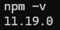
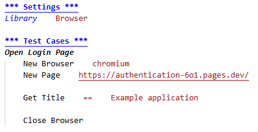

# Keskeneräinen harjoitustyö

Tämä harjoitustyö on toteutettu joulukuussa 2026 osana kurssia Ohjelmistokehityksen teknologioita (ajankohtaiset teknologiat) ja työn tavoitteena on tutustua ja opiskella itsenäisesti testiautomaatiotyökalun Robot Framework käyttöä.

## Taustat

Tässä tiedostossa kerron ohjeet tämän projektin pystyttämiseen, pyrkien syventämään tietoutta tarpeellisista vaiheista otettaessa Robot Frameworkia käyttöön. Kerron hieman yleistä tietoutta Robot Frameworkista sekä ohjeistuksen, mitä testaan Robot Frameworkilla projektissani. Testattavien asioiden ohjeistus mukailee kurssin toista tehtävänantoa, joka on laadittu Playwright-testien tekemiseen. Eli olen kurssilla aiemmin toteuttanut nämä samat testit kertaalleen, mutta työkalulla Playwright. Nyt opettelen itsenäisesti Robot Frameworkia tämän harjoitustyön parissa, kokemusta Robot Frameworkista minulla ei ennestään ole. Lisäksi osana harjoitustyötä laadin testit toiseen sovellukseen, tähän palaan dokumentin myöhemmässä vaiheessa. 

*”Tutustun Robot Frameworkiin ja koitan tehdä saman harjoituksen kuin teimme Playwright-tehtävässä. Mahdollisuuksien mukaan, kun aikaa riittää, kirjoitan Robot-testejä Ohjelmistoprojekti 1 -sovelluksellemme.”*

## Aloitus ja asennus

Harjoitustyöni aloitin luomalla Ohjelmistoprojekti 1 -sovelluksellemme robot-testejä. Sen jälkeen perustin tämän repositorion ja projektini lokaaleille tiedostoille virtuaalisen ympäristön.

Virtuaalisen ympäristön saat halutessasi näillä komennoilla (Windows), jotka ajetaan projektin juuressa, ennen muita Robot Frameworkin asennuksia:

```cmd
python -m venv .venv
.venv\Scripts\activate.bat
```

Virtuaalinen ympäristö eristää projektin riippuvuudet, estäen mahdolliset kirjastojen versioristiriidat, tehden projekteista toimintavarmempia (vanhat projektit ei rikkoudu version muuttuessa, kun tehdään uusia projekteja). Samalla myös järjestelmä ja Python-asennus pysyy puhtaampana, kun aliriippuvuudet ovat omissa virtuaaliympäristöissään. (https://docs.python.org/3/library/venv.html).

Mielenkiinnosta aihetta kohtaan löysin artikkelin, jossa Python-kehittäjä Marcin Kozak kehoittaa käyttämään virtuaaliympäristöjä heti alusta alkaen, jotta aloittelija voi säästyä myöhemmiltä harmeilta: https://medium.com/data-science/python-virtual-environments-why-and-when-should-you-use-them-be57b0c0323d.


Tämän jälkeen otetaan käyttöön Robot Framework:

```cmd
pip install robotframework
pip install robotframework-browser
rfbrowser init
```

HUOM. Itse ajoin nämä komennot ongelmitta, koska koneellani on NodeJS. Mikäli se puuttuu, rfbrowser init ei luultavasti onnistu (https://medium.com/@zorozeri/test-automation-using-robot-framework-with-browser-library-1-f994af6f78b1). Tämän vuoksi voi olla suositellumpaa suorittaa asennus seuraavalla komennolla, jolloin NodeJS:ää ei tarvita (https://robotframework-browser.org/#start), koska se tulee lisäosana:

```cmd
py -m pip install "robotframework-browser[bb]"
```

Halutessasi voit tarkastaa onko NodeJS asennettuna. Jos on, saat tuloksena versionumerot:

```cmd
node -v
npm -v
```



Kun Robot Framework ympäristö on kunnossa, voit muutaman testin tehtyäsi taikka myöhemmin, ajaa vielä tämän:

```cmd
pip freeze > requirements.txt
```

Tiedostosta requirements.txt käyvät ilmi projektin riippuvuudet. Versionumeroiden tallentaminen tiedostoon mahdollistaa, että muut projektin jäsenet (tässä projektissa heitä ei ole), taikka kuka vaan voi pystyttää testit täysin samanlaisessa ympäristössä. Mikäli et perustanut virtuaalista ympäristöä, requirements.txt listaa muidenkin projektiesi riippuvuudet, lista saattaa siinä tapauksessa olla pitkä.

## Ensimmäinen laatimani testi 

Aloitan laatimalla yksinkertaisen testin tiedostoon login.robot. Testi varmistaa vain selaimen ja testattavan sivuston aukeamisen. Sivuston title on nimetty "Example application", joten hyödynnän sitä:



### Ajan testin:

```cmd
py -m robot tests/login.robot
```


### Testien suorittamisen jälkeen muodostuvat:

- report.html – testiraportti
- log.html – testiloki
- output.xml – testitulokset

Nämä sekä mahdolliset muut testiajojen muodostamat tiedostot ja kansiot kannattaa lisätä tiedostoon .gitignore, jos projekti siirretään githubiin. Lisää sinne myös:

- .venv/ - virtuaaliympäristö
- browser/ - Browser-kirjaston tiedostot


# Harjoitustyön toinen osuus

Sisällytin harjoitustyöhöni tässä repositoriossa tekemieni testien lisäksi testien tekemisen kurssille Ohjelmistoprojekti 1. Olemme ko. kurssilla tehneet lipunmyynti-sovellusta Fullstack -työnä ja otin tehtäväkseni koodata työhön käyttöliittymää (käyttäjän näkökulmasta) testaavia automaatiotestejä (end-to-end) Robot Frameworkilla. Kaikki Robot-testit sekä tiimitovereitani varten laatima readme.md -ohjeistus ovat minun käsialaani, ja ne löytyvät osoitteesta: https://github.com/YKKOSET/Lippumyynti-ohjelma/tree/main/robot-tests. Päivitän ja lisään testejä joulukuulle 2026 asti, jolloin projektityömme on määrä valmistua. 


# Tietoa työkalusta Robot Framework


<!-- 
# Tänne tulee Ohjelmistokehityksen teknologioiden kurssin harkkatyön raportti!

Syventävää tietoa Robot Frameworkista.

Harkkatyön videoesittely erikseen. 

Muistan lisätä tänne myös linkit Ohjelmistoprojekti 1 tekemiini automaatiotesteihin, sekä esittelen ne videolla myös.


Lisää kuva onnistuneista testeistä (tässä repossa olevat). -->

<!-- Tunnukset piiloon. -->


-------------
# Tiivistelmä projektin teknologioista in english

## Robot Framework Authentication Tests

Test automation project built with Robot Framework and Browser Library.

### Features

- Login testing
- Registration testing
- Positive and negative test cases
- Browser automation

### Technologies

- Robot Framework
- Browser Library
- Playwright Engine
- Python

### Run tests

```cmd
py -m robot tests
py -m robot tests/login.robot
```
